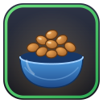

<p align="center"></p>

# Kibble

One button to feed, revive and call your hunter pet, for **WoW Forever** (interface 16001).

Kibble puts a single movable button on screen (and a key binding) that casts Feed Pet on the best food
in your bags. The ring around the button shows your pet's mood and pulses when it isn't happy, and
Kibble warns you when you have no food your pet will eat.

## Features

- **One click (or key press) feeding.** Picks the food for you. By default it saves your best food: it uses
  the cheapest food that still fully feeds your pet, and the highest level food otherwise.
- **Pet care.** With no living pet the same button revives a dead pet or calls a missing one, and **Ctrl-click mends**. (Can be switched off under Visibility.)
- **Vendor restock.** At a vendor that sells food your pet eats, a *Buy N pet food* button appears under the vendor window and tops you up to your target (20 / 40 / 80 / 120). Nothing is bought until you click it; it respects your gold, bag space and ignore list.
- **No wasted food.** A happy pet is not fed: the button refuses (and tells you) until the mood drops. Option *Don't feed a happy pet* under Food.
- **Mood ring.** Green, yellow or red around the button, pulsing when the pet is not happy.
- **No-food and low-food warnings.** On-screen message and chat line, rate limited. Optionally warn when you're down to 5, 10 or 20 foods, and play a sound (off by default; pick from four).
- **Feeding countdown.** A swipe on the button while your pet is eating, driven by the pet's feeding buff.
- **Right-click settings menu**
  - *Alerts:* on-screen / chat / sound (opt-in) / "getting hungry" hint, a low-food threshold, the alert sound, and how often alerts may repeat.
  - *Appearance:* size and opacity presets, lock position, show the food count, "NO FOOD" text and feeding countdown, reset position.
  - *Food:* "save best food", "smallest stack first" (frees bag space) or "always best food", plus an ignore list of foods Kibble must never use.
  - *Visibility:* always shown, faded while the pet is happy, or hidden; plus the pet-care option.
  - *Food* also has the vendor restock target, and *Appearance* the minimap button toggle.
- **Profiles, with import / export.** Each character uses a profile (new characters start on *Default*); make, copy, rename, reset and delete profiles from right-click > Profiles. *Export* gives a text string you can share, and *Import* turns a pasted string into a new profile. A profile holds all settings and the ignore list, not the button position. Also `/kibble profile [name]`, `/kibble export`, `/kibble import`.
- **Options panel, minimap button and addon-compartment entry.** Options > AddOns > Kibble has the on/off options and a button that opens the menu. The minimap button is draggable (click: menu, right-click: panel) and can be hidden.
- Only loads for hunters; the button only shows while a living pet is out.

## Install

Download the latest `Kibble-vX.Y.Z.zip` from [Releases](../../releases) and unzip it so you end up with
`World of Warcraft/_forever_/Interface/AddOns/Kibble/Kibble.toc`, then `/reload` or restart the game.

## Use

| Action | What it does |
| --- | --- |
| Left-click / key binding | Feed the pet (or revive / call it when it is dead / missing) |
| Ctrl-click | Mend Pet |
| Right-click | Open the settings menu |
| Shift-drag | Move the button (unless locked) |
| `/kibble` | Print pet mood and the food Kibble would pick |
| `/kibble config` | Open the settings menu (works even when the button is hidden) |
| `/kibble buffs` | List your pet's buffs (diagnostic: shows what the feeding buff is called on your client) |
| `/kibble profile [name]` | List the profiles, or switch this character to one |
| `/kibble export` / `import` | Share a profile as text / import one |
| `/kibble reset` | Put the button back in its default spot |

Bind a key under **Options > Key Bindings > AddOns > Kibble**.

## Notes

- Feeding is a protected action, so it only happens when you click or press the key. Kibble can't feed
  automatically, and it can't change the button's food, size or visibility driver in combat; those changes
  are applied as soon as combat ends. Revive / call / mend / feed is chosen by macro conditionals at click
  time, so it works in combat.
- **EllesmereUI:** if it's installed, Kibble's vendor button and options-panel widgets are restyled to match through EllesmereUI's skinning API (toggle per addon in EllesmereUI's options under *Third-Party Addons*). Without it, nothing changes.
- Saved settings live in `KibbleDB` (profiles in `KibbleDB.profiles`; the button position and minimap angle are per account). If you used this addon under its old name (FeedMe), your button
  position is carried over on first load. Delete the old `FeedMe` folder.

## Development

`tests/smoke.lua` runs the addon against a stub of the WoW API (no game needed); CI runs it on every push:

```
luajit tests/smoke.lua Kibble.lua
```

Releases are automatic: bump `## Version` in `Kibble.toc`, add a section to `CHANGELOG.md`, then push a
`vX.Y.Z` tag (see [publishing/README.md](publishing/README.md), which also covers CurseForge and Wago).

## License

MIT
